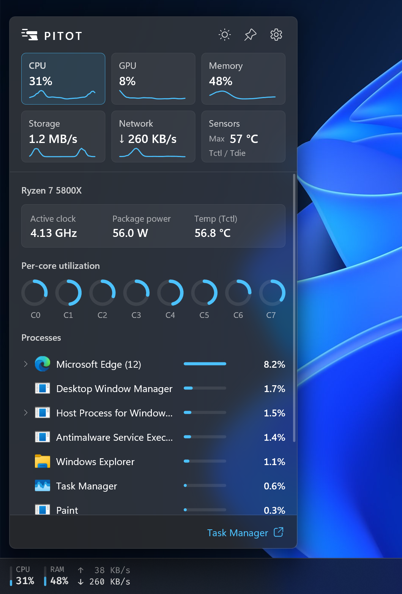
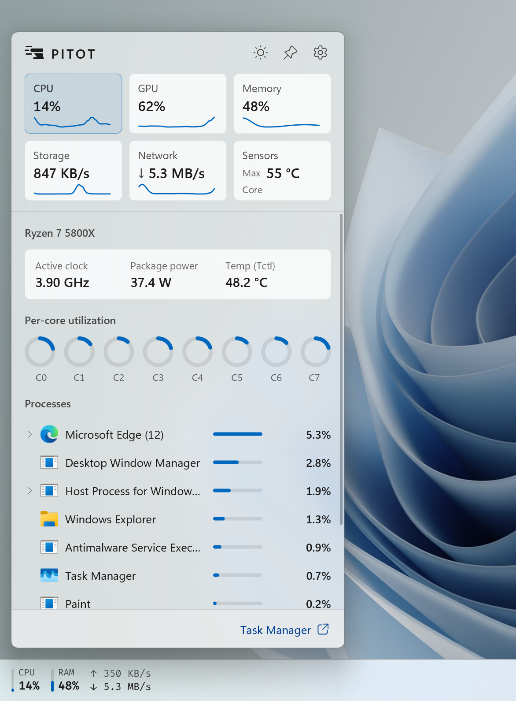
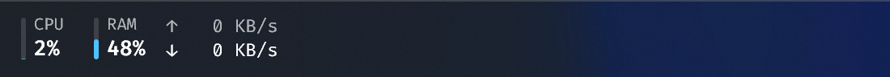
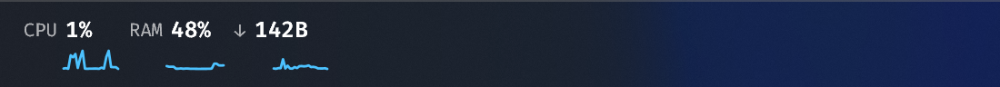
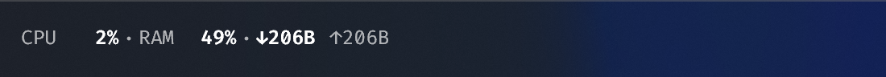
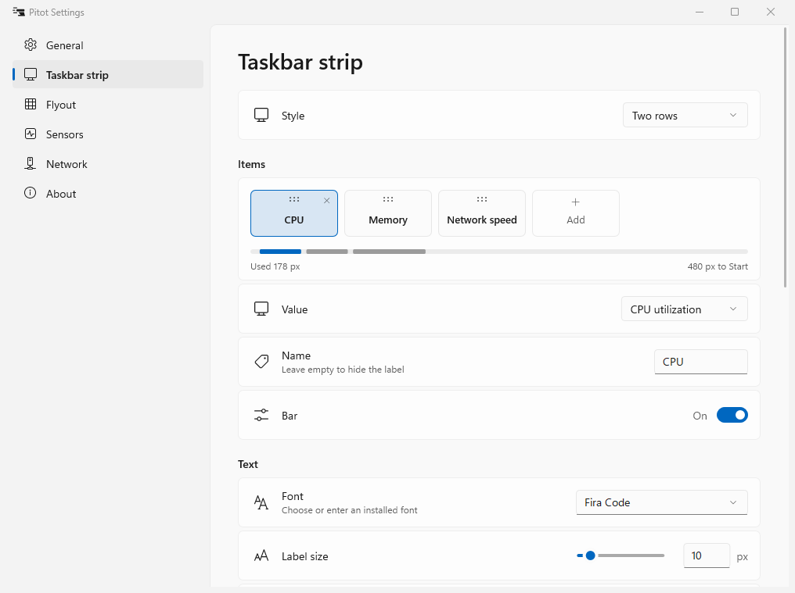

<p align="center">
  
</p>

<h1 align="center">Pitot</h1>

<p align="center">
  A lightweight hardware monitor that lives in the Windows 11 taskbar.
</p>

<p align="center">
  <a href="LICENSE"></a>
  
  
  
</p>

<p align="center">
  <a href="#features">Features</a> ·
  <a href="#getting-started">Getting started</a> ·
  <a href="#configuration">Configuration</a> ·
  <a href="#hardware-support">Hardware support</a> ·
  <a href="#faq">FAQ</a> ·
  <a href="#contributing">Contributing</a>
</p>

---

Pitot puts the numbers you care about in the empty part of the taskbar, and opens a flyout with everything else in one click: CPU, GPU, memory, storage, network, and every temperature and fan on the board.

It is native C++ with no .NET or web runtime. It uses about 10 MB of memory and well under 1% CPU when idle.

<p align="center">
  
  &nbsp;
  <br>
  <sub>The flyout and the taskbar strip, dark and light. The numbers are made up (demo mode).</sub>
</p>

## Features

### Taskbar strip

<p align="center">
  <br>
  <br>
  <br>
  <sub>The three strip styles: stacked rows, trend lines, single line.</sub>
</p>

- **Pick your items.** Up to eight, in any order: CPU, memory and GPU usage, CPU / GPU / SSD / motherboard temperature, disk activity, disk read/write, network speed.
- **Three styles.** Two stacked rows with usage bars, values with a small trend line, or one compact line.
- **Two positions.** Left of the Start button (centered taskbar icons) or left of the notification area, optionally on every monitor's taskbar.
- **Warning colors.** Temperatures, memory and disk activity change color at thresholds.
- **Adjustable.** Font, sizes, weight and every gap can be changed, and the settings page shows how much taskbar room is left.

### Flyout

Six tiles are both the overview and the navigation. Each has a trend line covering 1 to 60 minutes.

| Panel | What it shows |
| --- | --- |
| **CPU** | Model, effective clock, package power, temperature (Tctl on AMD, package on Intel), per-core load |
| **GPU** | Usage, clock, core temperature, VRAM; board power, fan, hotspot and memory temperature where the driver provides them |
| **Memory** | In use / modified / standby / free, committed, compressed, speed, page file |
| **Storage** | Used and total space of all disks in one bar; per disk: read, write, active time, NVMe temperature |
| **Network** | Speed of a chosen adapter, latency, today's and this month's traffic |
| **Sensors** | Every CPU, motherboard, GPU and SSD temperature and every fan; each can be hidden or renamed |

Every panel also lists its top processes, grouped like Task Manager, with per-process disk and network traffic from ETW. Right-click a process to end it.

### And more

- Light and dark themes that follow Windows, with an Acrylic background.
- Simplified Chinese and English UI.
- A Windows notification when a temperature stays above the hot threshold.
- Starts at logon through a scheduled task, without a UAC prompt.
- Works alongside [FanControl](https://github.com/Rem0o/FanControl.Releases): it shares the hardware access locks and never touches fan, voltage or clock settings.
- Degrades gracefully: a metric that cannot be read is hidden or explained, never shown as a fake 0.

## Getting started

### Requirements

- Windows 11, x64.
- Administrator rights. Sensor access, kernel ETW sessions and memory list information need them.
- The [PawnIO](https://pawnio.eu/) driver for CPU and motherboard sensors. Without it everything else still works, and the flyout says why the sensors are missing. On first launch without PawnIO, Pitot can download and open the official PawnIO installer for you.

### Install

Download Pitot from the [GitHub Releases](https://github.com/cheng-zongkai/Pitot/releases) page. Each release offers two downloads with the same files inside:

- **Installer (`Pitot-<version>-setup.exe`, recommended)** installs Pitot into `C:\Program Files\Pitot` and adds a Start menu shortcut.
- **Portable archive (`Pitot-<version>-win-x64.zip`)** runs from any folder you choose.

Both contain `Pitot.exe`, `PitotNvidia.dll`, `PitotAdlx.dll` and the license files. `PitotAdlx.dll` provides the extra AMD GPU metrics and has its own license, `PitotAdlx-EULA.txt`, which sits next to it; if you do not agree to that agreement, delete the DLL. Pitot runs without it. Each release also lists SHA-256 hashes in `SHA256SUMS.txt`.

The binaries are not code-signed, so Windows SmartScreen may show a warning; click **More info** and **Run anyway** if you trust the download.

With the installer:

1. Run `Pitot-<version>-setup.exe` and accept the UAC prompt.
2. To update, run the newer installer; it closes a running Pitot first.
3. Uninstall from **Settings > Apps**. This also removes the **Start at logon** task of the installed copy and keeps your settings and traffic history.

With the portable archive:

1. Extract **all** files into a permanent folder (for example, `C:\Tools\Pitot`). Do not run it from inside the archive or a temporary folder, and keep the DLLs next to `Pitot.exe`.
2. Run `Pitot.exe` and accept the UAC prompt.
3. When updating, right-click the taskbar strip to exit Pitot before replacing files. If you turn on **Start at logon** and later move or delete the folder, turn **Start at logon** off in Settings first (or toggle it off and back on after moving) so the scheduled task stays in sync.

### Build from source

If you prefer to build Pitot yourself, you need Visual Studio 2022 Build Tools with the C++ workload, CMake and Ninja:

```powershell
winget install --id Kitware.CMake -e
winget install --id Ninja-build.Ninja -e
winget install --id Microsoft.VisualStudio.2022.BuildTools -e --override "--quiet --wait --norestart --add Microsoft.VisualStudio.Workload.VCTools --includeRecommended"
```

Then build Debug and Release and run the unit tests:

```powershell
powershell -NoProfile -ExecutionPolicy Bypass -File .\scripts\build.ps1 -Config all -Test
```

The output is `build\x64-release\Pitot.exe`, with `PitotNvidia.dll` next to it. Keep the two together.

### Run

1. Start `Pitot.exe` and accept the UAC prompt. The strip appears in the taskbar.
2. Click an item to open the flyout on its panel. Click again or press <kbd>Esc</kbd> to close it. Pin the flyout to keep it open when it loses focus.
3. Open Settings with the gear in the flyout, and turn on **Start at logon** to skip the UAC prompt from then on.

Hover the strip for exact values. Right-click it to exit.

### GPU extras (optional)

Usage, clock, core temperature and VRAM work on any card. Board power, fan speed, hotspot and memory temperature come from the vendor's driver:

- **AMD** — through `PitotAdlx.dll`, which the installer and the archive include. It uses AMD's ADLX SDK under AMD's license, so the DLL has its own agreement, `PitotAdlx-EULA.txt`, and the SDK headers are not in this repository. When building from source, download the headers once (this accepts AMD's license), then build again to get `PitotAdlx.dll`:

  ```powershell
  powershell -NoProfile -ExecutionPolicy Bypass -File .\scripts\get-adlx.ps1 -AcceptAmdLicense
  ```

- **NVIDIA** — through `PitotNvidia.dll`, which is built with Pitot and calls `nvml.dll` and `nvapi64.dll` from the driver you already have. Which of the four metrics appear depends on the card and driver. This path was written against NVIDIA's public headers and has not yet run on an NVIDIA card; reports are welcome.

## Configuration

Everything is in the Settings window. It writes `%APPDATA%\Pitot\config.ini`, which you can also edit by hand; changes apply as soon as the file is saved.

<p align="center">
  
</p>

```ini
[strip]
; a = stacked rows, b = trend lines, c = single line
style = a
; left of Start, or right next to the notification area
position = left
items = cpu, memory, temp:gpu, net

[sensors]
warn = 60
hot = 80
notify = 1

; hide or rename any sensor
[sensor.nct6687d.0x104]
alias = VRM
```

The full list of settings is in [docs/configuration.md](docs/configuration.md).

## Hardware support

| Component | Supported | Source |
| --- | --- | --- |
| CPU usage, memory, disks, network | Any | Windows |
| CPU temperature, clock, power | AMD Zen (family 17h–1Ah); Intel Core and Atom with a package thermal sensor | PawnIO |
| Motherboard temperatures and fans | Nuvoton NCT6683D / 6686D / 6687D and NCT6779D–NCT6799D, ITE IT86xx / IT87xx, Fintek F718xx (most ASUS, ASRock, Gigabyte and MSI desktop boards) | PawnIO |
| GPU basics | Any | Windows (D3DKMT) |
| GPU extras | AMD, NVIDIA | ADLX, NVML / NVAPI |
| SSD temperature | NVMe | Windows storage API |

Pitot was built and tested on one machine: Ryzen 7 5700X, MSI PRO B550M-P WIFI6E, Radeon RX 9060 XT. If something is missing or wrong on yours, please open an issue with `pitot.log`.

### Known limitations

Anything below is hidden in the flyout rather than shown as 0.

- **Motherboard sensors.** Only the NCT6687D has been checked on real hardware. The Nuvoton NCT67xx, ITE and Fintek paths were written against LibreHardwareMonitor and have not yet run on those boards; reports are welcome. What each input is wired to depends on the board, so channels are named after the chip's inputs (SYSTIN, CPUTIN, AUXTIN…) or numbered ("Temp 1", "Fan 2"); rename them in Settings after comparing with HWiNFO. On NCT6687D boards the names follow the MSI layout, which newer MSI 800-series boards change. Not supported: Nuvoton NCT6701D, chips older than about 2013 (NCT6771F / 6776F, Winbond), and the extra ASUS embedded-controller sensors (some ROG boards show more in HWiNFO). An unknown chip is logged with its ID.
- **Laptop fans and board temperatures.** Laptops report these through the manufacturer's embedded controller, which differs by brand and often by model and has no public documentation. They are not read. The CPU, GPU and SSD readings still work on laptops.
- **Intel CPUs.** Package temperature, package power and effective clock only; per-core temperatures are not read. This path was written against the Intel SDM and LibreHardwareMonitor and has not yet run on an Intel machine; reports are welcome.
- **AMD CPUs.** Per-CCD temperatures exist only on Zen 2 / Zen 3 desktop, Threadripper 3000, Zen 4 desktop and Zen 5 desktop. Other Zen parts (first-generation Zen, APUs, mobile) show Tctl only.
- **Other CPU vendors** (Zhaoxin, VIA) have no CPU sensors.
- **GPU extras.** AMD needs `PitotAdlx.dll`; the release downloads include it, and a source build only produces it after you download the ADLX headers (see above). The NVIDIA path has not yet run on an NVIDIA card. Intel graphics, including Arc, have the basic metrics only.
- **SATA disks** (SSD or hard drive) have no temperature; only NVMe drives report one.
- **More than 64 logical processors.** Per-core load and the effective clock cover the first 64.
- **PawnIO is required** for every CPU and motherboard sensor, and some anti-cheat software blocks it.

## FAQ

**Why does it need administrator rights?**
Reading CPU and motherboard sensors, per-process disk and network traffic (kernel ETW) and the memory breakdown all require them.

**Is it safe next to FanControl or HWiNFO?**
Pitot does not change fan, voltage or clock settings. It takes the same global locks that FanControl and LibreHardwareMonitor use before touching the sensor chips, and skips a round if it cannot get them. The only setting it changes: on Nuvoton NCT6791D and newer chips it clears the BIOS lock on the hardware monitor's I/O ports when that lock is set, as FanControl and LibreHardwareMonitor do. The full list of writes is in [docs/hardware.md](docs/hardware.md#writes-pitot-performs).

**The CPU and motherboard sensors are missing.**
Install the [PawnIO](https://pawnio.eu/) driver. Some anti-cheat software blocks it; the flyout's status bar says so when that happens.

**The strip does not fit.**
With left-aligned taskbar icons there is no room before Start; switch the position to the notification-area side in Settings.

**Where are the logs?**
`%LOCALAPPDATA%\Pitot\pitot.log`. If Pitot crashes, a small `crash-*.dmp` is written next to it. Please attach both to an issue.

**Windows SmartScreen warns about the exe.**
Local builds and unsigned release binaries do not carry an Authenticode publisher signature. SmartScreen uses the reputation of the file and its publisher. A trusted code-signing certificate identifies the publisher, and a newly signed release can still show a warning while it gains reputation. See [Microsoft's SmartScreen guidance](https://learn.microsoft.com/en-us/windows/apps/package-and-deploy/smartscreen-reputation).

## Contributing

Issues, hardware compatibility reports, and pull requests are welcome! See [CONTRIBUTING.md](CONTRIBUTING.md) for prerequisites, coding conventions, and PR checklists, and [SECURITY.md](SECURITY.md) for vulnerability reporting.

- [Developer documentation](docs/README.md) covers the architecture, individual subsystems, and verification.
- [docs/decisions/](docs/decisions/README.md) — architecture decision records
- [AGENTS.md](AGENTS.md) — working rules for AI coding agents

Fan control, overclocking, and ARM64 are out of scope.

## Acknowledgements

- [PawnIO](https://pawnio.eu/) by namazso, for safe hardware access from user mode.
- [LibreHardwareMonitor](https://github.com/LibreHardwareMonitor/LibreHardwareMonitor), the reference for register layouts and decoding formulas. No code is copied.
- [phnt](https://github.com/winsiderss/phnt), for native API structure layouts.

## License

Pitot is released under the [MIT License](LICENSE).

It embeds the signed PawnIO modules (LGPL-2.1-or-later, source in `third_party/pawnio/`). The optional `PitotAdlx.dll` uses the AMD ADLX SDK under AMD's license, so the built DLL is distributed under [PitotAdlx-EULA.txt](PitotAdlx-EULA.txt), not under MIT. `PitotNvidia.dll` is Pitot's own code; the NVIDIA driver DLLs it calls are not distributed with Pitot. Details are in [THIRD_PARTY_NOTICES.md](THIRD_PARTY_NOTICES.md).
